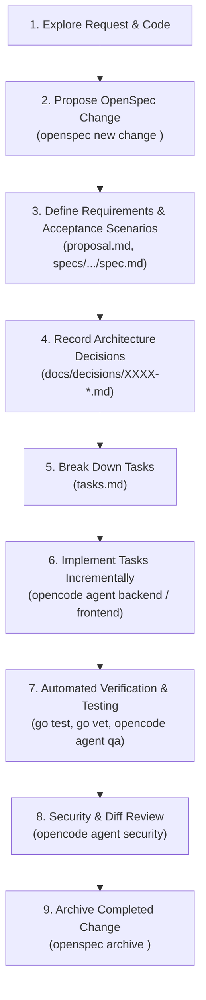

# Feature Development Lifecycle

This workflow governs how new features and architectural changes are proposed, implemented, verified, and archived using OpenSpec, OpenCode, and Antigravity.

---

## 1. Lifecycle Overview



---

## 2. Step-by-Step Execution Guide

### Step 1: Explore the Request and Codebase
- Assess scope and review existing specifications in `openspec/specs/`.
- Inspect only relevant domain packages (`internal/<domain>/`).
- **Proportional Scope Check**:
  - *Trivial Changes* (typos, docs, non-functional tweaks): Implement directly; skip OpenSpec ceremony.
  - *Non-Trivial Changes* (new endpoints, schema changes, tenancy logic, business rules): Proceed with OpenSpec.

### Step 2: Propose the Change
Initialize a new OpenSpec change directory:
```powershell
openspec new change <change-name>
# Example: openspec new change crm-contact-management
```
Or use the OpenCode / Antigravity slash command:
```
/opsx-propose "Implement CRM Contact Management with tenant isolation"
```

### Step 3: Define Requirements and Acceptance Scenarios
Author the change artifacts under `openspec/changes/<change-name>/`:
- `proposal.md`: Problem statement, business motivation, scope, and out-of-scope non-goals.
- `specs/<capability>/spec.md`: Delta specifications using concrete Given-When-Then scenarios:
  ```markdown
  ### Scenario: Successful Contact Creation within Tenant
  - **Given** an authenticated user belonging to Tenant `T1`
  - **When** sending POST `/contacts` with valid details
  - **Then** status 201 Created is returned
  - **And** the record is tagged with `tenant_id: T1`
  - **And** Tenant `T2` cannot view this contact
  ```

### Step 4: Record Architecture Decisions (Where Applicable)
If the feature alters database patterns, adds third-party integrations, or introduces new security boundaries:
- Author an ADR using `docs/decisions/0000-template.md`.
- Save as `docs/decisions/<next-num>-<slug>.md`.

### Step 5: Break Implementation into Small Tasks
In `openspec/changes/<change-name>/tasks.md`:
- List fine-grained, verifiable tasks.
- Keep each task to 1-2 hours of implementation.
- Pair each code change task with an automated test task.

### Step 6: Implement Tasks Incrementally
- Use OpenCode with the `backend` or `frontend` agent:
  ```powershell
  opencode --agent backend run "Implement contact validation in internal/crm/contact.go"
  ```
- Keep diffs small and focused on the active task.
- Never modify unrelated packages or introduce unrequested abstractions.

### Step 7: Run Tests and Verify Implementation
- QA Engineer agent authors test cases covering the acceptance scenarios.
- Execute validation commands:
  ```powershell
  go test -v -race ./...
  go test -cover ./...
  go vet ./...
  gofmt -l .
  ```
- Antigravity validates UI states (Loading, Empty, Success, Error, Denied) for frontend changes.

### Step 8: Security & Diff Review
- Invoke the review-only `security` agent:
  ```powershell
  opencode --agent security run "Audit tenant isolation and input boundaries in openspec/changes/<change-name>"
  ```
- Confirm zero hardcoded secrets and strict `tenant_id` query scoping.

### Step 9: Archive Completed Change
Once all acceptance criteria are met, validation passes, and the diff is clean:
```powershell
openspec validate --all
openspec archive <change-name>
```
OpenSpec automatically archives the change directory and syncs delta specifications into `openspec/specs/`.
